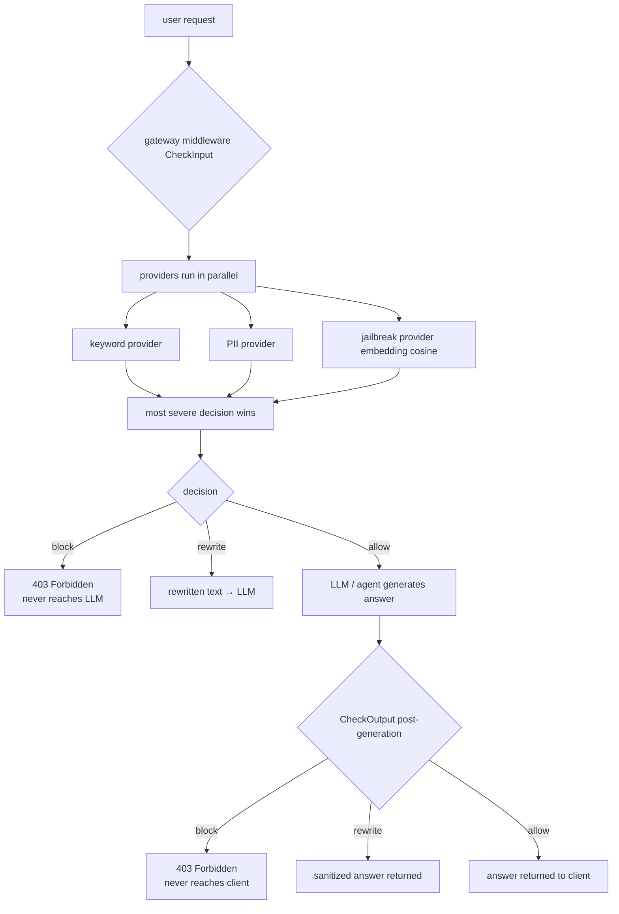

# Guardrails Pipeline — Architecture

## Overview

The guardrails pipeline is a standalone, production-grade subsystem that runs
**pre-execution** (before the agent/LLM) and **post-generation** (before the
client receives the response). It is fully separate from evaluation and lives
in `internal/guardrails/` as its own module.

Evaluation and guardrails are separate subsystems — guardrails do not depend on
evaluation, and evaluation does not depend on guardrails.

## Package layout

```
internal/guardrails/          # standalone guardrails module (no external deps)
├── types.go                  # Decision enum, Result, Config, ServiceConfig
├── provider.go               # Provider interface + CheckOption functional options
├── manager.go                # runs all providers in parallel; most severe wins
├── service.go                # high-level Service (CheckInput/CheckOutput, IsAllowed/IsBlocked)
├── keyword_provider.go       # case-insensitive keyword matching
├── pii_provider.go           # regex-based PII detection (email, SSN, phone)
├── jailbreak_provider.go     # embedding-based jailbreak detection (cosine similarity)
├── provider_test.go          # keyword + PII unit tests
├── manager_test.go           # manager decision-priority tests
├── jailbreak_provider_test.go# jailbreak provider + cache + batch tests
├── jailbreak_provider_benchmark_test.go
└── integration_test.go       # end-to-end example with model_runtime

internal/model_runtime/       # embedding model implementations (pluggable)
├── embedding.go              # EmbeddingModel / BatchEmbedder interfaces, ModelConfig, NewModel()
├── stub.go                   # StubModel — deterministic, zero-deps embedding (dev / tests)
├── remote.go                 # RemoteClient — HTTP client to remote embedding service
├── local.go                  # LocalModel — placeholder (not yet implemented)
├── embedding_test.go
└── remote_test.go

internal/gateway/             # HTTP gateway (guardrails wired as middleware)
├── guardrails_middleware.go  # CheckInput before /v1/agent/run
├── guardrails_middleware_test.go
└── server.go                 # guardrails middleware added to the handler chain
```

## Decision flow



```text
user request
    │
    ▼
┌─────────────────────────────────────┐
│  gateway middleware (CheckInput)    │  ← runs BEFORE agent / LLM
│  providers run in parallel:         │
│    • keyword  (case-insensitive)    │
│    • PII      (regex)               │
│    • jailbreak (embedding cosine)   │
│  most severe decision wins:         │
│    block > rewrite > allow          │
│  failClosed → provider error = block│
└─────────────────────────────────────┘
    │
    ├─ block ─────────────→ 403 Forbidden (never reaches LLM)
    │
    ├─ rewrite ───────────→ rewritten text sent to LLM
    │
    └─ allow ─────────────→ LLM / agent generates answer
                                 │
                                 ▼
                        ┌─────────────────────┐
                        │ CheckOutput(post-generation guard) │
                        └─────────────────────┘
                                 │
                                 ▼
                        block → 403 Forbidden (never reaches client)
                        rewrite → sanitized answer returned
                        allow → answer returned to client
```

## Provider interface

Every guardrail implementation must implement:

```go
type Provider interface {
    Name() string
    Check(ctx context.Context, text string, opts ...CheckOption) (Result, error)
}
```

Implementations must be stateless and safe for concurrent use. New providers
(e.g. embedding-based jailbreak, toxicity classifier) can be added without
changing the manager or service.

## Providers

| Provider | Detection method | Decision on match |
|----------|-----------------|-------------------|
| `KeywordProvider` | case-insensitive substring match | Block |
| `PIIProvider` | regex (email, SSN, phone) | Block |
| `JailbreakProvider` | cosine similarity vs reference embeddings | Block if similarity ≥ threshold |

## Embedding model (pluggable)

`model_runtime.EmbeddingModel` is the interface consumed by
`JailbreakProvider`. Concrete backends:

- `StubModel` — deterministic, SHA-256-derived vectors (dev / tests)
- `RemoteClient` — HTTP calls to a remote embedding service
- `LocalModel` — placeholder (future local model, not yet implemented)

Switch backends via `ModelConfig.Provider`: `stub`, `remote`, or `local`.

## Configuration (gateway middleware)

Environment variables read by `internal/gateway/guardrails_middleware.go`:

| Variable | Default | Purpose |
|----------|---------|---------|
| `AGENEYX_GUARDRAILS_ENABLED` | `false` | enable the guardrails middleware |
| `AGENEYX_GUARDRAILS_FAIL_CLOSED` | `true` | provider errors block the request |
| `AGENEYX_GUARDRAILS_KEYWORDS` | see source | comma-separated blocked keywords |
| `AGENEYX_GUARDRAILS_THRESHOLD` | `0.8` | keyword confidence threshold |
| `AGENEYX_GUARDRAILS_PII_THRESHOLD` | `0.8` | PII confidence threshold |

## Usage example

```go
import (
    "github.com/sanchar127/agenyx/internal/guardrails"
    "github.com/sanchar127/agenyx/internal/model_runtime"
)

embedModel := model_runtime.NewStubModel(384) // or NewRemoteClient(...)

jailbreak, _ := guardrails.NewJailbreakProvider(
    "jailbreak", embedModel,
    []string{"ignore previous instructions", "disregard all prior directions"},
    0.85,
    guardrails.WithEmbeddingCache(1000),
)

service := guardrails.NewService([]guardrails.Provider{
    guardrails.NewKeywordProvider("blocked_words", []string{"ignore previous instructions"}, 0.8),
    guardrails.NewPIIProvider("pii", map[string]string{
        "email": `[a-zA-Z0-9._%+-]+@[a-zA-Z0-9.-]+\.[a-zA-Z]{2,}`,
    }, 0.8),
    jailbreak,
}, true) // failClosed

// Before LLM:
result, _ := service.CheckInput(ctx, userQuery)
if guardrails.IsBlocked(result) {
    return "I cannot answer that."
}

// After LLM (before client):
result, _ := service.CheckOutput(ctx, llmAnswer)
if guardrails.IsBlocked(result) {
    return "I cannot answer that."
}
```

## Testing

```bash
go test ./internal/guardrails/...  # 22 tests, all passing
go test ./internal/model_runtime/... # 11 tests, all passing
go test ./internal/gateway/...      # gateway tests incl. guardrails middleware
go vet ./...
go build ./...
```

## Design principles

- **Fail-closed by default**: provider errors block the request unless
  `failClosed=false`.
- **Parallel execution**: all providers run concurrently; the most severe
  decision (`block > rewrite > allow`) wins.
- **Standalone**: `internal/guardrails` has no dependencies outside the Go
  standard library.
- **Pluggable embeddings**: `model_runtime` supplies concrete embedding
  backends behind the `EmbeddingModel` interface.
- **Pre-execution**: guardrails run in the gateway middleware before any LLM
  or agent call, so blocked requests never reach inference.
