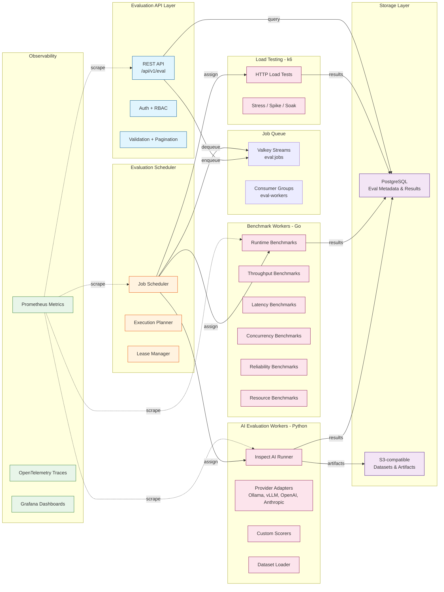
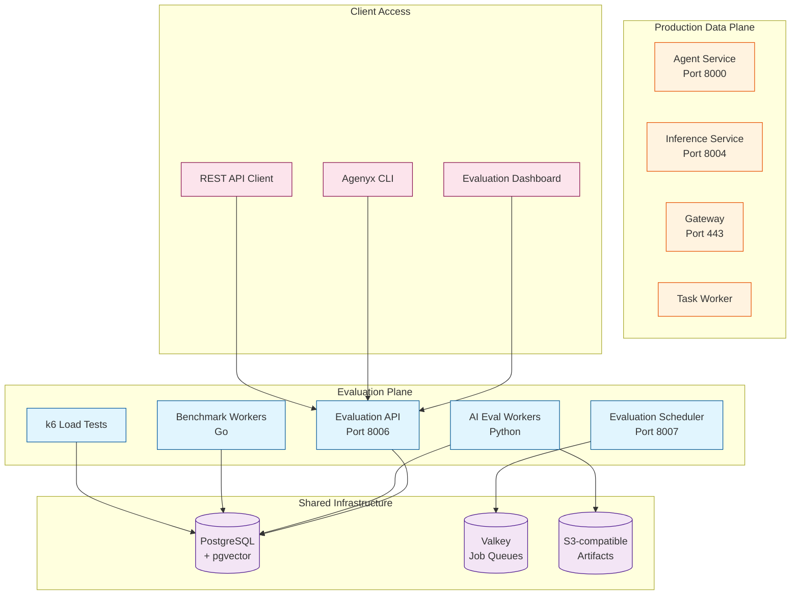

# Evaluation Architecture

## Component Responsibility Diagram



## Execution Boundaries

| Boundary | Responsibility | Isolation Mechanism |
|----------|---------------|---------------------|
| **Evaluation API** | Request ingress, auth, validation | Separate HTTP server (port 8006) |
| **Evaluation Scheduler** | Job planning, queue management | Separate process, own Valkey consumer group |
| **AI Evaluation Workers** | Inspect AI execution | Docker containers, CPU/memory limits |
| **Benchmark Workers** | Go benchmark execution | Docker containers, CPU/memory limits |
| **Load Testing Workers** | k6 load generation | Separate network namespace |
| **Production Path** | Agent execution, LLM inference | **Completely separate** queues and workers |

## Infrastructure Map



## Worker Pool Architecture

```
Worker Pools (independently scalable):

┌─────────────────────────────────────────────────────────────┐
│  AI Evaluation Worker Pool (Python)                         │
│  ├── Concurrency: 4 workers                                 │
│  ├── CPU limit: 2 cores per worker                          │
│  ├── Memory limit: 4Gi per worker                           │
│  ├── Queue: eval:workers:ai                                  │
│  └── Workloads: LLM eval, agent eval, tool eval             │
└─────────────────────────────────────────────────────────────┘

┌─────────────────────────────────────────────────────────────┐
│  Benchmark Worker Pool (Go)                                 │
│  ├── Concurrency: 2 workers                                 │
│  ├── CPU limit: 4 cores per worker                          │
│  ├── Memory limit: 8Gi per worker                           │
│  ├── Queue: eval:workers:bench                              │
│  └── Workloads: runtime, throughput, latency benchmarks     │
└─────────────────────────────────────────────────────────────┘

┌─────────────────────────────────────────────────────────────┐
│  Load Test Worker Pool (k6)                                 │
│  ├── Concurrency: 1 worker                                  │
│  ├── CPU limit: 2 cores                                     │
│  ├── Memory limit: 2Gi                                      │
│  ├── Queue: eval:workers:loadtest                            │
│  └── Workloads: stress, spike, soak tests                   │
└─────────────────────────────────────────────────────────────┘
```

## Resource Isolation

- Evaluation workers run in **separate Docker containers** with CPU/memory limits
- Evaluation uses **separate Valkey consumer groups** (`eval-workers-*`) isolated from production `agenyx-workers`
- Evaluation API listens on **port 8006**, separate from production ports (8000, 8004, 8005, 443)
- Evaluation PostgreSQL tables use **separate schema** (`evaluation_*`) to avoid production table contention
- Large artifacts (traces, logs, datasets) stored in **S3-compatible storage**, not PostgreSQL
