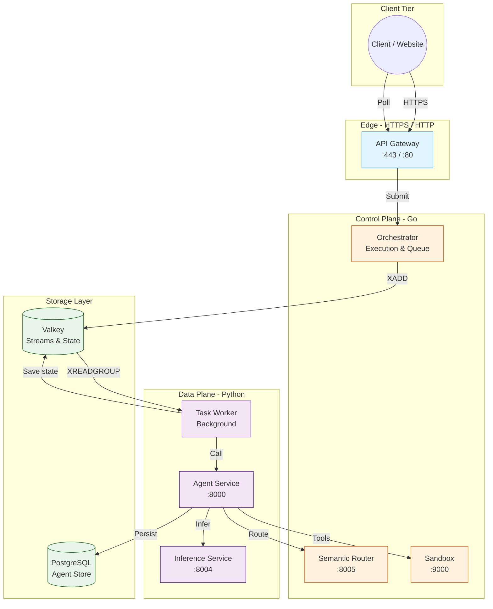

# Architecture

Agenyx follows a **control plane / data plane** separation. The control plane (Go) handles ingestion, authentication, orchestration, and routing. The data plane (Python) handles agent reasoning, LLM inference, and asynchronous task execution.

## Control Plane (Go)

The control plane is responsible for receiving requests, enforcing security, and coordinating execution. It consists of:

| Component | Role |
|-----------|------|
| **API Gateway** | TLS termination, API key auth, authorization, rate limiting, CORS, request routing |
| **Orchestrator** | Execution submission, task queuing, execution state management |
| **Semantic Router** | Model selection, scoring, session affinity, constraint filtering |
| **Sandbox** | gVisor-isolated tool execution with resource limits |
| **CLI** | `agenyx serve` — builds and deploys the platform via Docker Compose |

## Data Plane (Python)

The data plane is responsible for executing agent workloads. It consists of:

| Component | Role |
|-----------|------|
| **Agent Service** | LLM reasoning, planning, tool execution, Postgres persistence |
| **Inference Service** | OpenAI-compatible LLM gateway, provider failover, circuit breaking |
| **Task Worker** | Stream consumption, task execution, retry with backoff, dead-lettering |

## Storage

| Store | Role |
|-------|------|
| **Valkey** | Task streams (XADD/XREADGROUP), execution state hashes, rate-limiter buckets, router session state |
| **PostgreSQL** | Durable agent execution storage (via Agent service, SQLAlchemy + Alembic) |

## Architecture Diagram

## Cross-Cutting Concerns

| Concern | Implementation |
|---------|---------------|
| **Authentication** | Bearer API key (`AGENEYX_API_KEY`) on gateway `/v1/` routes; service key (`INFERENCE_SERVICE_API_KEY`) on inference |
| **Authorization** | Permission-based (`agents:run`, `tasks:read`) enforced by gateway middleware |
| **Rate Limiting** | Per-client-IP token bucket (configurable requests/second + burst) |
| **Observability** | Structured JSON logs, Prometheus metrics, OpenTelemetry tracing |
| **Resilience** | Failover, circuit breaking, exponential backoff retries, dead-letter queues |
| **Security** | gVisor sandboxing, read-only rootfs, dropped capabilities, no-new-privileges |
