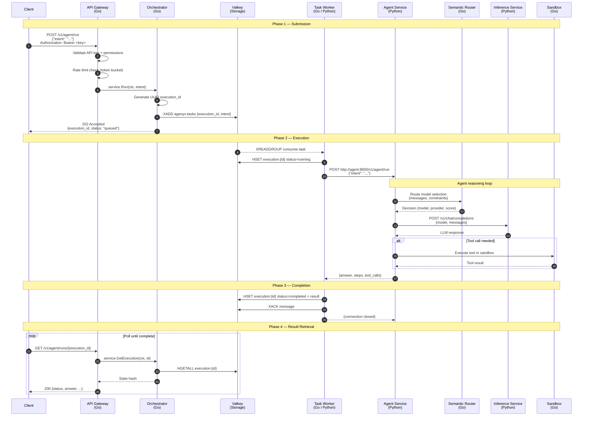

# Request Lifecycle

This document describes the end-to-end flow of an agent execution through Agenyx, from the initial client request to the final result.

## Lifecycle Diagram

## Phase Details

### Phase 1: Submission

1. **Client** sends `POST /v1/agent/run` with an `intent` string and a Bearer API key.
2. **API Gateway** validates the API key, checks permissions (`agents:run`), enforces rate limits, and applies CORS/security headers.
3. **Orchestrator** generates a UUID `execution_id` and submits the task to a Valkey stream (`agenyx:tasks`).
4. **Client** receives `202 Accepted` with the `execution_id` and `status: "queued"`.

### Phase 2: Execution

1. **Task Worker** consumes the task from the Valkey stream using `XREADGROUP`.
2. **Worker** marks the execution as `running` in Valkey (`agenyx:execution:{id}`).
3. **Worker** calls the Agent service at `POST http://agent:8000/v1/agent/run`.
4. **Agent** reasons over the intent:
   - Selects a model via the **Semantic Router** (constraints, scoring, session affinity).
   - Calls the **Inference Service** for LLM completion.
   - Optionally executes tools in the **Sandbox** (gVisor-isolated).
5. **Agent** returns `{answer, steps, tool_calls}` to the worker.

### Phase 3: Completion

1. **Worker** writes the final result to Valkey (`status: "completed"` or `"failed"`).
2. **Worker** acknowledges the Valkey message (`XACK`).
3. If the agent call failed, the worker retries with exponential backoff. After max attempts, the task is dead-lettered.

### Phase 4: Result Retrieval

1. **Client** polls `GET /v1/agent/runs/{execution_id}` to read execution state.
2. **Gateway** → **Orchestrator** → **Valkey** returns the execution hash.
3. **Client** receives the final state (`queued`, `running`, `retrying`, `completed`, or `failed`) plus any result.

## Execution States

| State | Meaning |
|-------|---------|
| `queued` | Task accepted, waiting in Valkey stream. |
| `running` | Worker picked up the task, executing via Agent. |
| `retrying` | Task failed, waiting for next retry attempt. |
| `completed` | Execution finished successfully; result available. |
| `failed` | Exhausted all retries; dead-lettered. |
