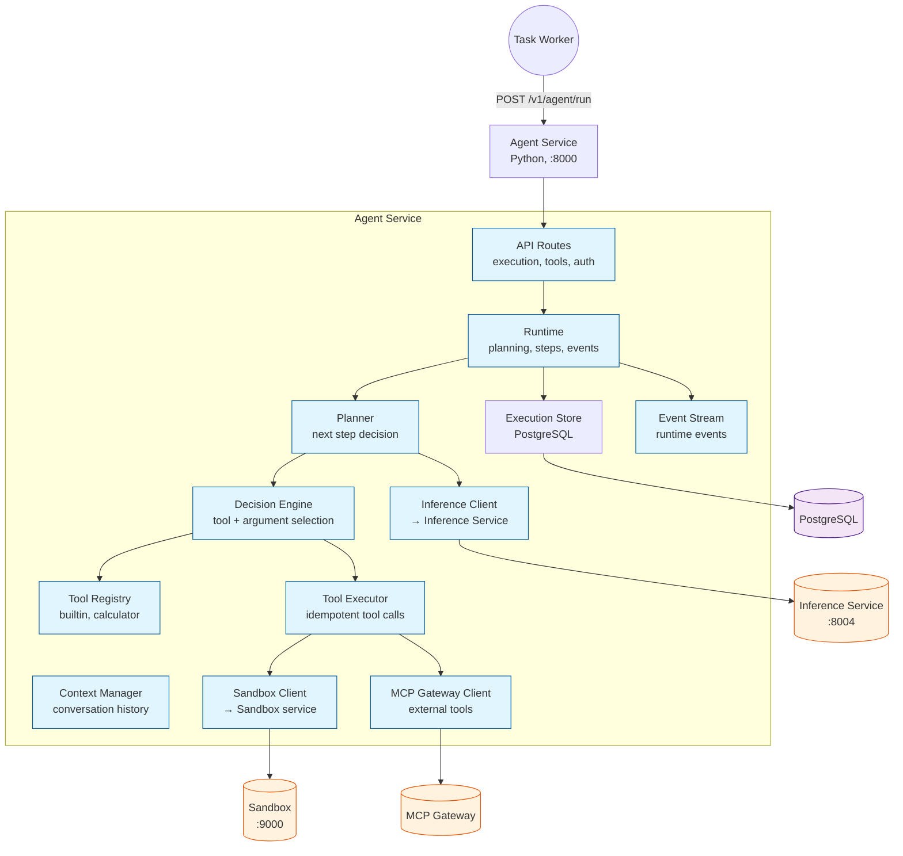

# Agent Service

## Objective

The Agent Service's objective is to **be the reasoning core of Agenyx** — accepting execution intents, planning and running multi-step agent runs using LLMs, invoking tools (including sandboxed tools), and persisting execution state to PostgreSQL.

## What It Does

| Capability | Description |
|------------|-------------|
| **Reasoning** | Plan and execute multi-step agent runs using an LLM. |
| **Tool execution** | Run builtin tools and calculator; route tool calls through the sandbox when isolation is needed. |
| **MCP gateway routing** | Connect to Model Context Protocol servers for external tools. |
| **Persistence** | Store executions, steps, and results in PostgreSQL (via SQLAlchemy/Alembic migrations). |
| **Streaming** | Stream runtime events to clients during execution. |
| **Authorization & idempotency** | Authorize actions and guarantee idempotent retries. |
| **Crash recovery** | Recover in-flight executions after worker or process failure. |

## Architecture

## Integration

| Integration | Environment Variable | Default |
|-------------|---------------------|---------|
| Inference | `AGENTYX_INFERENCE_BASE_URL` | `http://inference:8004` |
| Router | `AGENTYX_ROUTER_BASE_URL` | `http://router:8005` |
| Sandbox | `AGENTYX_SANDBOX_BASE_URL` | `http://sandbox:9000` |
| Database | `AGENTYX_DATABASE_URL` | (required) |
| MCP Gateway | `AGENEYX_MCP_GATEWAY_TOKEN` | (required) |
| Inference API Key | `AGENTYX_INFERENCE_SERVICE_API_KEY` | (required) |

## Port

The Agent service runs on port `8000` and is reachable at `http://agent:8000` within Docker Compose.
