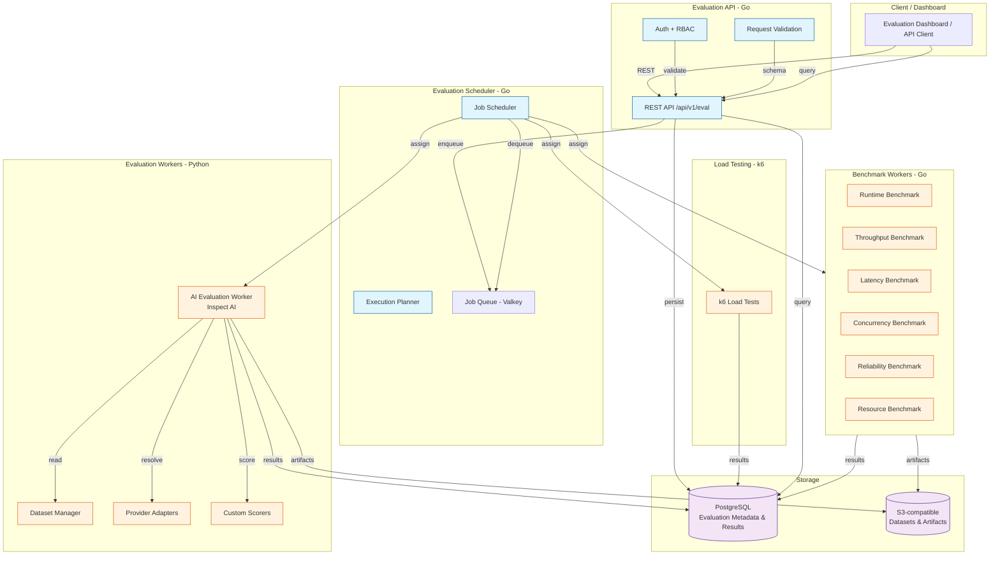
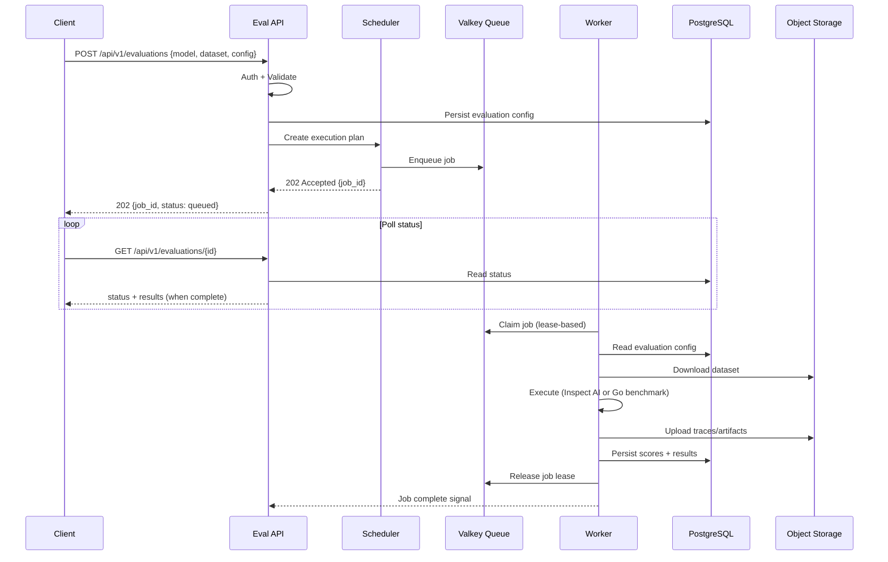

# Evaluation Platform

## Objective

Agenyx includes a production-grade **Evaluation and Benchmarking Platform** that independently evaluates:

1. **LLM models and inference providers** — correctness, latency, cost, structured output
2. **AI agent behavior and task completion** — multi-step execution, tool selection, recovery
3. **Tool calling and tool execution** — success rate, latency, error propagation
4. **Agent orchestration and scheduling** — queue latency, worker assignment, fairness
5. **Sandbox execution and isolation** — startup overhead, resource enforcement, timeout
6. **Distributed runtime performance** — RPS, concurrency, p50/p95/p99 latency
7. **End-to-end system reliability** — failure rate, recovery behavior
8. **Production performance and resource efficiency** — CPU, memory, GPU, network

## Design Principles

| Principle | Description |
|-----------|-------------|
| **Operational isolation** | Evaluation runs on separate workers and queues; it never interferes with production inference or agent paths |
| **Independent scalability** | AI evaluation workers, Go benchmark workers, and load-test workers scale independently |
| **Model independence** | Same evaluation runs against any registered model/provider without code changes |
| **Async job execution** | All evaluations are asynchronous jobs with lifecycle management |
| **Reproducible benchmarks** | Every run records an immutable configuration snapshot |
| **Result comparison** | Historical results are comparable across models, providers, and runtime versions |
| **Extensible plugins** | New models, providers, benchmarks, and scorers plug in without framework changes |
| **No unnecessary microservices** | Logical modules share deployment units where appropriate |
| **Reuse existing infrastructure** | PostgreSQL for metadata, Valkey for job queues, existing Docker Compose/K8s patterns |

## Logical Architecture



## Logical Modules

| Module | Language | Role |
|--------|----------|------|
| Evaluation API | Go | REST API, auth, validation, job lifecycle |
| Evaluation Scheduler | Go | Job scheduling, execution planning, queue management |
| AI Evaluation Worker | Python | Inspect AI execution, provider adapters, custom scorers |
| Benchmark Worker | Go | Runtime, throughput, latency, concurrency, reliability benchmarks |
| Load Testing Worker | k6 | HTTP load, stress, spike, soak testing |
| Dataset Manager | Python | Dataset versioning, checksums, S3 artifact storage |
| Model Registry | PostgreSQL | Model/provider registration and capability metadata |
| Results Collector | Python/Go | Result persistence, trace collection |
| Result Comparison Engine | Python/Go | Comparative reports across models/runtimes |
| Report Generator | Python/Go | HTML/JSON/PDF evaluation reports |

## Data Flow



## Technology Stack

| Layer | Technology |
|-------|-----------|
| Evaluation API | Go 1.26, net/http, chi router |
| Evaluation Scheduler | Go, go-redis (Valkey) |
| AI Evaluation Workers | Python, Inspect AI |
| Benchmark Workers | Go, custom benchmark harness |
| Load Testing | k6 |
| Job Queue | Valkey (existing) |
| Metadata Store | PostgreSQL (existing, pgvector extension) |
| Artifact Store | S3-compatible (MinIO in dev, S3 in prod) |
| Observability | Prometheus, OpenTelemetry, Grafana |
| Container | Docker Compose, Kubernetes (kustomize) |

## Deployment Profile

The evaluation platform uses a **separate deployment profile** that can be started/stopped independently:

```bash
# Start evaluation platform only
docker compose -f docker-compose.yml -f docker-compose.eval.yml up -d

# Stop without affecting production
docker compose -f docker-compose.yml -f docker-compose.eval.yml down
```

Production services continue operating when the evaluation platform is stopped.

## Project Status

- ✅ Architecture documentation
- 🚧 Evaluation foundation (API, scheduler, job lifecycle)
- 🚧 Inspect AI integration
- 🚧 Go benchmark engine
- 🚧 Worker pools and auto-scaling
- 🚧 Results comparison and reporting
- 🚧 Docker deployment configuration
- 🚧 Automated tests
