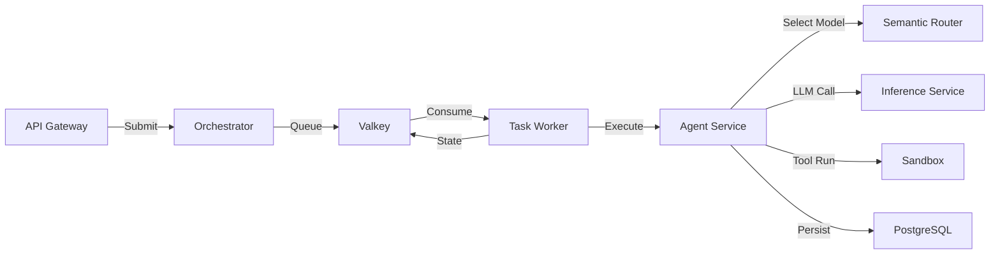

# Components

Agenyx is composed of several subsystems that work together to run AI agents. Each subsystem has a specific objective and well-defined responsibilities.

## Component Quick Reference

| Component | Language | Objective | Port |
|-----------|----------|-----------|------|
| [API Gateway](./gateway.mdx) | Go | Secure ingress: authenticate, authorize, rate limit, and route execution requests | 443 / 80 |
| [Orchestrator](./orchestrator.mdx) | Go | Accept intents, queue tasks, and track execution state via Valkey | embedded |
| [Semantic Router](./router.mdx) | Go | Select the best model for an inference request using scoring and session affinity | 8005 |
| [Inference Service](./inference.mdx) | Python | Provide an OpenAI-compatible LLM gateway with failover and circuit breaking | 8004 |
| [Task Worker](./worker.mdx) | Go / Python | Consume queued tasks, execute them via the Agent, and handle retries/failures | background |
| [Agent Service](./agent.mdx) | Python | Reason over intents, plan steps, execute tools, and persist results | 8000 |
| [Sandbox](./sandbox.mdx) | Go | Execute agent tools in isolated, resource-constrained containers via gVisor | 9000 |
| [MCP Gateway](./mcp-gateway.mdx) | Go | Connect agents to external Model Context Protocol servers | embedded |

## Component Interaction

Select a component below to view its detailed documentation, including its objective, responsibilities, architecture, API, and configuration.

### API Gateway
Secure entry point to the platform. Handles TLS, authentication, authorization, rate limiting, CORS, and routes execution requests to the orchestrator.

### Orchestrator
Receives execution intents from the gateway, assigns execution IDs, queues tasks in Valkey, and stores execution state.

### Semantic Router
Selects the optimal model for each inference request by evaluating candidates against constraints, applying scoring strategies, and managing session-level model affinity.

### Inference Service
Exposes a single OpenAI-compatible `/v1/chat/completions` endpoint. Routes requests to backend providers with failover, circuit breaking, concurrency control, and observability.

### Task Worker
Consumes tasks from Valkey streams, calls the Agent service to execute them, records results, retries with exponential backoff, and dead-letters failed tasks.

### Agent Service
The reasoning core of Agenyx. Plans and executes multi-step agent runs using LLMs, invokes tools (including sandboxed tools), and persists execution state to PostgreSQL.

### Sandbox
Provides isolated tool execution using gVisor (runsc) with strict resource limits (memory, CPU, PIDs, filesystem, network).

### MCP Gateway
Connects Agenyx agents to external Model Context Protocol (MCP) servers, extending the agent's tool capabilities.
