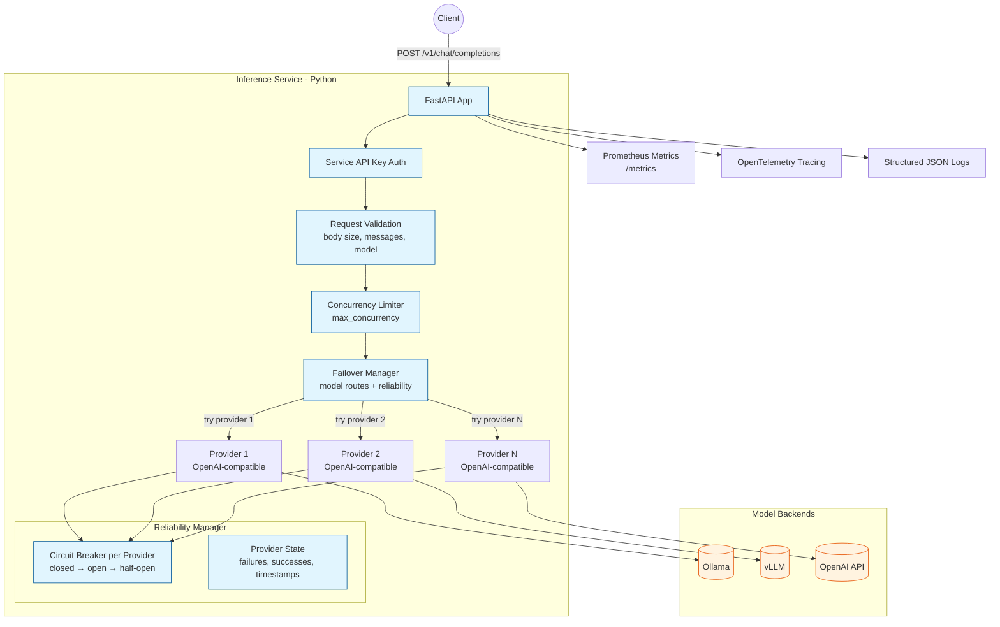
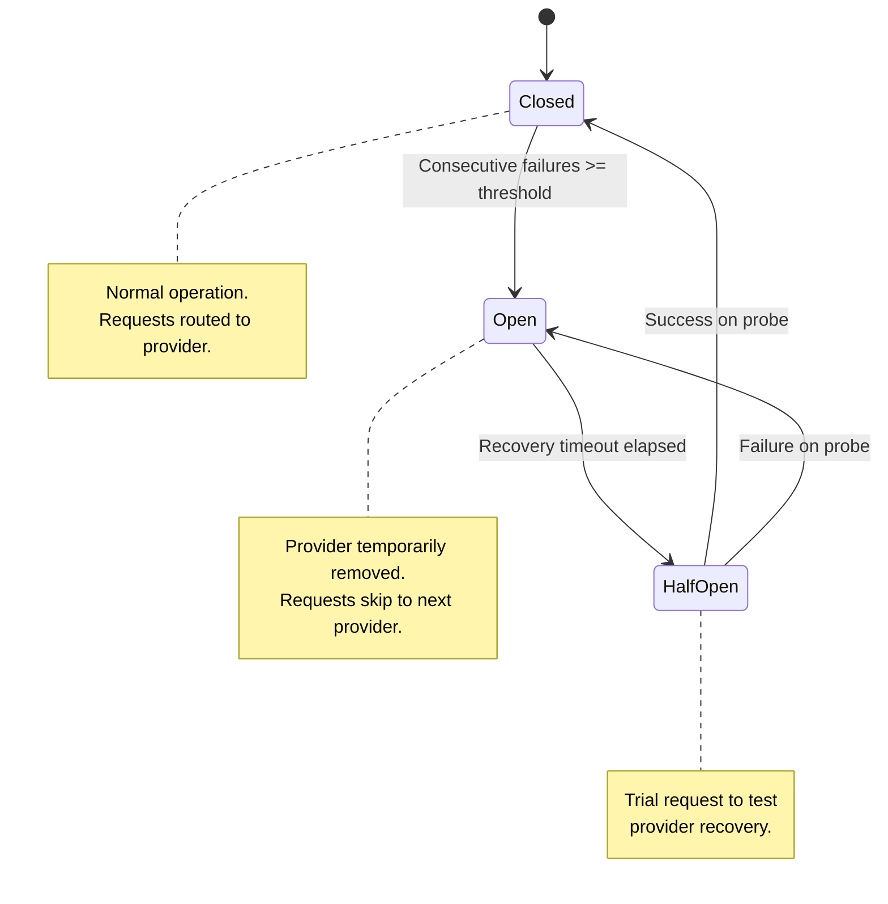

# Inference Service

## Objective

Agenyx Inference's objective is to **provide a single, stable OpenAI-compatible LLM API** that routes requests to backend providers with automatic failover, circuit breaking, concurrency control, and full observability — while remaining an internal microservice not exposed directly to end users.

## What It Does

- **One stable API** — `/v1/chat/completions` regardless of which backend serves the model.
- **Provider failover** — a model can be routed to a prioritized list of providers; if one fails, the next is tried automatically.
- **Circuit breaking** — a provider that keeps failing is temporarily taken out of rotation instead of being hammered with more requests.
- **Concurrency control** — an in-process admission limiter protects the service (and the backends) from being overwhelmed.
- **Structured observability** — JSON logs, Prometheus metrics, and OpenTelemetry tracing out of the box.

## Architecture



## Endpoints

| Method | Path | Description | Auth |
|--------|------|-------------|------|
| GET | `/health` | Liveness probe | No |
| GET | `/ready` | Readiness probe (at least one provider reachable) | No |
| GET | `/metrics` | Prometheus metrics | No |
| GET | `/v1/models` | List registered models | Yes |
| GET | `/v1/providers` | List registered providers | Yes |
| GET | `/v1/reliability` | Provider reliability / circuit-breaker state | Yes |
| POST | `/v1/chat/completions` | OpenAI-compatible chat completion | Yes (`X-Agenyx-Service-Key`) |

### Chat Completions

**Request**

```http
POST /v1/chat/completions
Content-Type: application/json
X-Agenyx-Service-Key: <INFERENCE_SERVICE_API_KEY>

{
  "model": "qwen2.5:7b",
  "messages": [{"role": "user", "content": "Hello!"}]
}
```

**Response**

```json
{
  "id": "chatcmpl-...",
  "object": "chat.completion",
  "created": 1700000000,
  "model": "qwen2.5:7b",
  "choices": [
    {
      "index": 0,
      "message": {"role": "assistant", "content": "Hi there!"},
      "finish_reason": "stop"
    }
  ],
  "usage": {...}
}
```

Response headers: `X-Agenyx-Provider`, `X-Agenyx-Model`.

## Provider Failover & Circuit Breaking

Each model is mapped to one or more providers in priority order. On a provider failure, the failover manager tries the next provider in the list.

### Circuit States



Read the current state at `GET /v1/reliability`.

## Concurrency Control

An in-process admission limiter caps the number of concurrent inference requests (`max_concurrency`, default `10`). Requests above the limit receive `429` (`INFERENCE_CONCURRENCY_LIMIT`) until capacity frees.

## Observability

- **Structured JSON logs** — every request and error is logged as JSON.
- **Prometheus metrics** — `GET /metrics` exposes HTTP request counts/durations/errors and inference-specific counters.
- **OpenTelemetry tracing** — traces exported to an OTLP endpoint (default `http://agenyx-otel-collector.monitoring.svc.cluster.local:4317`).

## Error Codes

| Code | HTTP | Meaning |
|------|------|---------|
| `INVALID_JSON` | `400` | Request body is not valid JSON. |
| `INVALID_MESSAGES` | `400` | `messages` missing or empty. |
| `MODEL_NOT_FOUND` | `404` | Requested model is not registered. |
| `STREAMING_NOT_IMPLEMENTED` | `501` | `"stream": true` is not yet supported. |
| `INFERENCE_CONCURRENCY_LIMIT` | `429` | Concurrency limit reached. |
| `MODEL_UNAVAILABLE` | `503` | No failover route configured for the model. |
| `INFERENCE_FAILED` | `503` | All failover providers exhausted. |
| `INTERNAL_SERVER_ERROR` | `500` | Unexpected error (details logged server-side). |

## Configuration

Configuration is loaded from `config/inference.yaml` with `INFERENCE_`-prefixed environment variables overriding YAML.

| Setting | Default | Description |
|---------|---------|-------------|
| `max_retries` | `2` | Max retries per provider request |
| `request_timeout_seconds` | `120.0` | Upstream request timeout |
| `max_connections` | `100` | HTTP client max connections |
| `max_concurrency` | `10` | Concurrent admission limit |
| `max_failover_attempts` | `3` | Max failover attempts per model |
| `max_request_body_bytes` | `1048576` | Max request body size |
| `max_messages` | `100` | Max messages per request |

## Project Status

- ✅ Non-streaming chat completions with provider failover and circuit breaking
- ✅ Prometheus metrics, structured JSON logging, OpenTelemetry tracing
- ✅ Docker image with Kubernetes-friendly liveness/readiness probes
- 🚧 Streaming (`"stream": true`) — returns `501 Not Implemented`
- 🚧 Tenant-based model authorization (`app/tenancy/`) exists and is unit-tested but not yet wired into the request path
