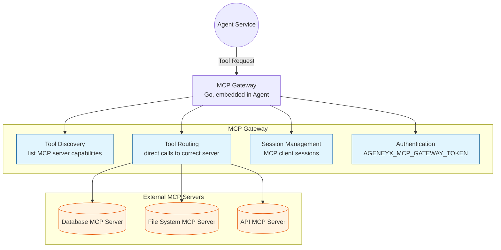

# MCP Gateway

## Objective

The MCP Gateway's objective is to **enable Agenyx agents to discover and invoke tools exposed by external Model Context Protocol (MCP) servers** — extending the agent's built-in tool set with capabilities from databases, file systems, APIs, and other MCP-compliant services.

## What It Does

- Discovers tools and resources exposed by MCP servers.
- Routes agent tool calls to the appropriate MCP server.
- Manages MCP client sessions and protocol framing.
- Authenticates MCP connections via `AGENEYX_MCP_GATEWAY_TOKEN`.

## Architecture



## Configuration

The MCP Gateway is configured through a gateway recipe (`recipes/mcp-gateway/default.yaml`):

```yaml
apiVersion: agenyx.ai/v1alpha1
kind: GatewayRecipe
metadata:
  name: mcp-gateway
spec:
  # MCP server endpoints and tool mappings
```

The token `AGENEYX_MCP_GATEWAY_TOKEN` must be set in the environment for the Agent service to authenticate with the MCP Gateway.

## Integration

The Agent service uses the MCP Gateway to extend its built-in tool set with capabilities exposed by external MCP servers (databases, file systems, APIs, etc.).

## Related

- [Agent Service](./agent.mdx) — consumes MCP Gateway tools.
- [API Gateway](./gateway.mdx) — ingress and auth for MCP routes.
