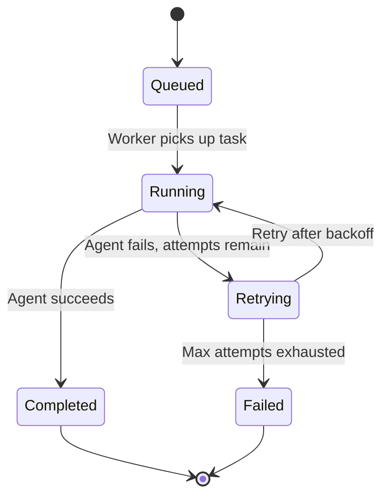

# Orchestrator

## Objective

The Orchestrator's objective is to **accept agent execution intents, durably queue them, and track their lifecycle** — acting as the bridge between the synchronous gateway API and the asynchronous execution plane.

## What It Does

- Accepts an execution `intent` and assigns a UUID `execution_id`.
- Submits the task to a Valkey-backed task queue for a worker to consume.
- Stores and retrieves execution state (queued → running → completed/retrying/failed).
- Exposes readiness by pinging the underlying queue (used by the gateway's `/health/ready` probe).

## Architecture

```mermaid
graph TB
    GW[API Gateway] -->|POST /v1/agent/run| ORC[Orchestrator Service]

    subgraph Orchestrator [Orchestrator - Go]
        ORC[Service<br/>Run() / GetExecution()]
        Q[Queue Interface<br/>Submit / GetExecution]
    end

    subgraph Valkey [Valkey - Storage]
        VK_STREAM[(Task Stream<br/>agenyx:tasks)]
        VK_STATE[(Execution State<br/>agenyx:execution:{id})]
    end

    GW --> ORC
    ORC --> Q
    Q -->|XADD| VK_STREAM
    Q -->|HGETALL| VK_STATE

    W[Task Worker] -->|XREADGROUP| VK_STREAM
    W -->|HSET| VK_STATE

    classDef comp fill:#e1f5fe,stroke:#01579b;
    classDef store fill:#f3e5f5,stroke:#4a148c;

    class GW,ORC,Q comp;
    class VK_STREAM,VK_STATE store;
```

## API

The orchestrator is exposed through the gateway:

| Method | Path | Description |
|--------|------|-------------|
| POST | `/v1/agent/run` | Submit an execution; returns `202 Accepted` with `execution_id` and `status: "queued"` |
| GET | `/v1/agent/runs/{execution_id}` | Read execution state and results |

### Submit an Execution

**Request**

```json
POST /v1/agent/run
Content-Type: application/json

{
  "intent": "Summarize the quarterly sales data and draft a follow-up email"
}
```

**Response** (`202 Accepted`)

```json
{
  "execution_id": "550e8400-e29b-41d4-a716-446655440000",
  "status": "queued"
}
```

### Read Execution State

**Response** (`200 OK`)

```json
{
  "execution_id": "550e8400-e29b-41d4-a716-446655440000",
  "status": "completed",
  "answer": "...",
  "attempt": "1",
  "worker": "agenyx-go-worker",
  "started_at": "...",
  "completed_at": "...",
  "duration_ms": "1240",
  "tool_calls": "[...]"
}
```

Possible `status` values: `queued`, `running`, `retrying`, `completed`, `failed`.

## Execution States



| State | Meaning |
|-------|---------|
| `queued` | Task accepted and waiting in the Valkey stream. |
| `running` | A worker has picked up the task and is executing it. |
| `retrying` | The task failed and is waiting for its next retry attempt. |
| `completed` | Execution finished successfully; result stored. |
| `failed` | Exhausted all retry attempts; dead-lettered. |

## Errors

| Error | HTTP Code | Condition |
|-------|-----------|-----------|
| `ErrInvalidIntent` | `422 Unprocessable Entity` | Intent is empty or whitespace. |
| `ErrQueueUnavailable` | `503 Service Unavailable` | Valkey queue cannot be reached. |
| `ErrExecutionNotFound` | `404 Not Found` | No state exists for the execution ID. |
| `ErrStateUnavailable` | `503 Service Unavailable` | State store read failed. |

## Queue

The orchestrator uses a `Queue` interface (`Submit`, `GetExecution`) backed by Valkey. The concrete implementation shares the task stream and execution-state keys with the task worker. Execution state is stored in Valkey hashes under `agenyx:execution:{execution_id}`.
