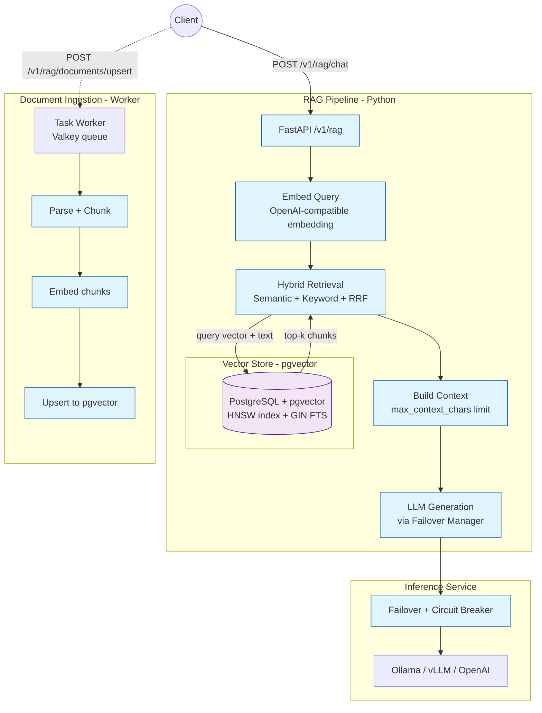

# RAG Pipeline

Agenyx includes a production-grade **Retrieval-Augmented Generation (RAG)**
pipeline that grounds LLM answers in your own documents. It combines
semantic vector search (pgvector) with full-text keyword search using
Reciprocal Rank Fusion (RRF), then injects the retrieved context into the
LLM prompt via the existing inference failover infrastructure.

## Objective

Provide a reliable, observable, and secure RAG service that:

- **Retrieves** relevant document chunks using hybrid search (semantic + keyword)
- **Augments** the LLM prompt with retrieved context and source citations
- **Generates** answers through the existing OpenAI-compatible inference gateway
- **Ingests** documents asynchronously via the task worker

## Architecture



## Endpoints

| Method | Path | Description | Auth |
|--------|------|-------------|------|
| POST | `/v1/rag/chat` | Retrieval-augmented generation | Yes (`X-Agenyx-Service-Key`) |
| POST | `/v1/rag/search` | Hybrid retrieval only (no generation) | Yes |
| POST | `/v1/rag/embeddings` | Embed one or more texts | Yes |
| POST | `/v1/rag/documents/upsert` | Upsert document chunks to vector store | Yes |
| GET | `/v1/rag/health` | RAG dependency health | Yes |

### Chat (RAG)

**Request**

```http
POST /v1/rag/chat
Content-Type: application/json
X-Agenyx-Service-Key: <INFERENCE_SERVICE_API_KEY>

{
  "query": "How does Agenyx handle task retries?",
  "document_id": "optional-scope-doc-id",
  "model": "qwen2.5:7b"
}
```

**Response**

```json
{
  "answer": "Agenyx retries failed tasks with exponential backoff...",
  "model": "qwen2.5:7b",
  "provider": "ollama-local",
  "sources": [
    {
      "index": 1,
      "document_id": "worker.mdx",
      "chunk_index": 0,
      "score": 0.92,
      "search_type": "semantic",
      "metadata": {},
      "content_preview": "The worker retries tasks..."
    }
  ],
  "chunks_retrieved": 3,
  "usage": {},
  "timing_ms": {
    "embed": 45.2,
    "retrieve": 32.1,
    "generate": 512.3,
    "total": 590.6
  }
}
```

Response headers: none beyond standard. Sources use `[Source N]` citation
notation in the answer text.

### Search (Retrieval Only)

```http
POST /v1/rag/search
Content-Type: application/json
X-Agenyx-Service-Key: <INFERENCE_SERVICE_API_KEY>

{
  "query": "task retry policy"
}
```

Returns the raw retrieved chunks with fused scores, useful for debugging
retrieval quality.

### Embeddings

```http
POST /v1/rag/embeddings
Content-Type: application/json
X-Agenyx-Service-Key: <INFERENCE_SERVICE_API_KEY>

{
  "input": ["document text here"]
}
```

Returns embedding vectors. Used internally by the ingestion worker.

### Document Upsert

```http
POST /v1/rag/documents/upsert
Content-Type: application/json
X-Agenyx-Service-Key: <INFERENCE_SERVICE_API_KEY>

{
  "document_id": "doc-123",
  "chunks": [
    {
      "chunk_index": 0,
      "content": "chunk text",
      "embedding": [0.1, 0.2, ...],
      "metadata": {"source": "upload.pdf"}
    }
  ]
}
```

Used by the ingestion worker to store embedded chunks.

## Hybrid Retrieval

Retrieval combines two search strategies:

1. **Semantic search** — cosine similarity over pgvector embeddings (HNSW index)
2. **Keyword search** — PostgreSQL full-text search (tsvector + GIN index)

Results are merged with **Reciprocal Rank Fusion (RRF)**:

```
score = semantic_weight * RRF(semantic_rank)
      + keyword_weight * RRF(keyword_rank)
```

Default weights: 70% semantic, 30% keyword. Results are capped per
document (`max_chunks_per_document`, default 5) to prevent a single long
document from dominating the context.

## Vector Store

- **Backend**: PostgreSQL with [pgvector](https://github.com/pgvector/pgvector)
- **Index**: HNSW (`vector_cosine_ops`) for fast approximate nearest-neighbor search
- **Full-text**: GIN index on `to_tsvector('english', content)` for keyword search
- **Extension**: Created automatically on startup via `CREATE EXTENSION IF NOT EXISTS vector`

The connection string is configured via `rag.vector_store.database_url`
(inference.yaml) or `RAG__VECTOR_STORE__DATABASE_URL` environment variable.

## Configuration

Configuration lives in `config/inference.yaml` under the `rag:` key,
with `RAG__`-prefixed environment variables overriding YAML.

| Setting | Default | Description |
|---------|---------|-------------|
| `rag.enabled` | `true` | Enable the RAG pipeline |
| `rag.embedding.provider` | `ollama-local` | Embedding provider name |
| `rag.embedding.model` | `nomic-embed-text` | Embedding model |
| `rag.embedding.dimensions` | `768` | Embedding vector dimensions |
| `rag.vector_store.database_url` | `postgresql+asyncpg://...` | pgvector connection string |
| `rag.vector_store.embedding_dimensions` | `768` | Must match embedding dimensions |
| `rag.vector_store.distance_metric` | `cosine` | `cosine`, `l2`, or `ip` |
| `rag.retrieval.top_k` | `10` | Final chunks returned |
| `rag.retrieval.hybrid_top_k` | `50` | Candidates per strategy before fusion |
| `rag.retrieval.semantic_weight` | `0.7` | Semantic weight in RRF |
| `rag.retrieval.keyword_weight` | `0.3` | Keyword weight in RRF |
| `rag.retrieval.min_score` | `0.0` | Minimum similarity score |
| `rag.retrieval.max_chunks_per_document` | `5` | Cap chunks per document |
| `rag.generation.model` | `qwen2.5:7b` | LLM model for answer generation |
| `rag.generation.max_context_chars` | `12000` | Max context characters injected |
| `rag.generation.temperature` | `0.2` | Generation temperature |
| `rag.generation.max_tokens` | `1000` | Max generation tokens |
| `rag.chunking.chunk_size` | `1000` | Characters per chunk |
| `rag.chunking.chunk_overlap` | `200` | Overlap between chunks |

Embedding dimensions and vector store dimensions **must match**.

## Document Ingestion

Documents are ingested asynchronously through the task worker:

1. **Submit** an ingestion task with document content and metadata
2. **Parse** — split text into overlapping chunks
3. **Embed** — call `/v1/rag/embeddings` on the inference service
4. **Upsert** — call `/v1/rag/documents/upsert` to store in pgvector

Example ingestion payload:

```json
{
  "execution_id": "exec-123",
  "document_id": "doc-456",
  "content": "Long document text...",
  "content_type": "text/markdown",
  "metadata": {
    "source": "upload.pdf",
    "author": "alice",
    "url": "https://example.com/doc.pdf"
  }
}
```

## Observability

- **Structured JSON logs** — every RAG request logs query length, chunk
  count, context size, and per-stage timing (embed / retrieve / generate)
- **Prometheus metrics**:
  - `agenyx_rag_requests_total` — RAG requests by endpoint and status
  - `agenyx_rag_request_duration_seconds` — request duration histogram
  - `agenyx_rag_chunks_retrieved` — chunks retrieved per request
  - `agenyx_rag_context_chars` — context characters injected
- **OpenTelemetry tracing** — spans for embed, retrieve, and generate stages

## Error Codes

| Code | HTTP | Meaning |
|------|------|---------|
| `INVALID_QUERY` | 400 | Query missing or empty |
| `INVALID_DOCUMENT_ID` | 400 | document_id is not a string |
| `INVALID_MODEL` | 400 | model is not a string |
| `INVALID_CHUNKS` | 400 | chunks missing or empty |
| `RAG_NOT_INITIALIZED` | 503 | RAG pipeline failed to start |
| `RAG_FAILED` | 503 | RAG pipeline error (embedding/retrieval/generation) |
| `EMBEDDING_FAILED` | 503 | Embedding provider unavailable |
| `RETRIEVAL_FAILED` | 503 | Retrieval error |
| `UPSCERT_FAILED` | 503 | Vector store upsert error |

## Project Status

- ✅ Hybrid retrieval (semantic + keyword + RRF)
- ✅ pgvector backend with HNSW + GIN indexes
- ✅ Context-augmented generation with source citations
- ✅ Document ingestion worker (chunk → embed → upsert)
- ✅ Structured logging, Prometheus metrics, OpenTelemetry tracing
- ✅ Unit and integration tests
- 🚧 Document parsing for PDF/DOCX/HTML (text/markdown supported today)
- 🚧 Re-ranking (cross-encoder) — `rerank` flag reserved
- 🚅 Streaming RAG responses
