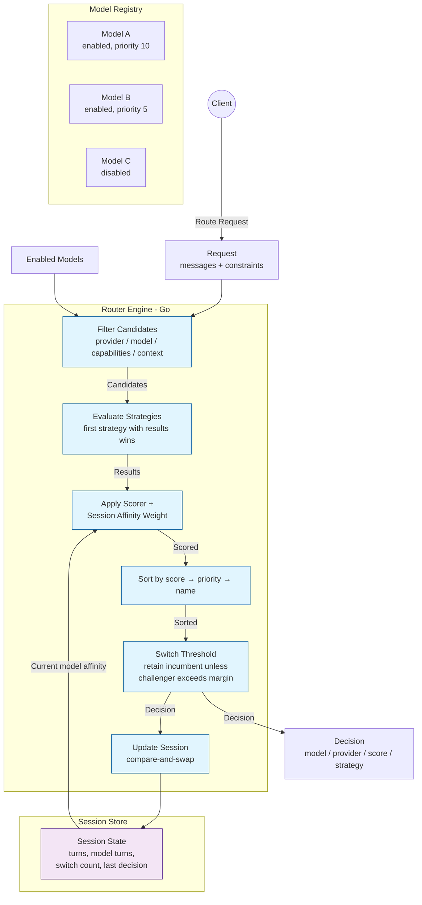
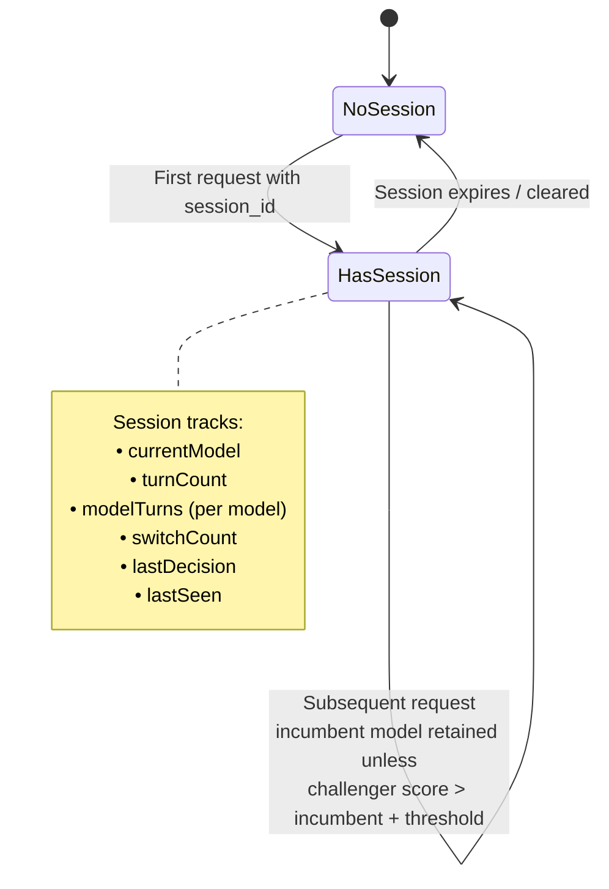

# Semantic Router

## Objective

The Semantic Router's objective is to **select the best model to serve each inference request** — evaluating candidates against constraints, applying scoring strategies, and managing session-level model affinity to avoid unnecessary model switching mid-conversation.

## What It Does

- Filters candidate models by provider, model name, capabilities, and minimum context window.
- Runs scoring strategies to rank candidates.
- Applies a scorer and session-affinity weight.
- Prevents unnecessary model switching via a configurable switch threshold.
- Maintains session state (turn count, model turns, switch count, last decision).

## Architecture

## Request Constraints

| Field | Type | Description |
|-------|------|-------------|
| `required_capabilities` | `[]string` | Capabilities the selected model must support. |
| `allowed_providers` | `[]string` | Restrict to these providers (case-insensitive). |
| `allowed_models` | `[]string` | Restrict to these model names. |
| `min_context_window` | `int` | Minimum context window the model must provide. |

## Model

| Field | Type | Description |
|-------|------|-------------|
| `name` | string | Model identifier. |
| `provider` | string | Inference provider serving the model. |
| `capabilities` | `[]string` | Capabilities the model supports. |
| `context_window` | int | Maximum context window size. |
| `priority` | int | Tie-breaker priority (higher wins). |
| `enabled` | bool | Whether the model is eligible for selection. |

## Decision

| Field | Type | Description |
|-------|------|-------------|
| `model` | string | Selected model name. |
| `provider` | string | Selected provider. |
| `score` | float64 | Final score of the selected model. |
| `strategy` | string | Name of the strategy that produced the result. |
| `candidates` | `[]Candidate` | All considered candidates with scores. |

## Session Affinity

To avoid flickering between models mid-conversation, the router tracks each session's current model. A challenger must exceed the incumbent's score by the `SwitchThreshold` to displace it.

## Configuration

| Setting | Meaning | Default |
|---------|---------|---------|
| `AffinityWeight` | Bonus added to the session's current model score | configurable |
| `SwitchThreshold` | Score margin required to switch models | configurable |

## Port

The router service runs on port `8005` and is reachable at `http://router:8005` within Docker Compose.
