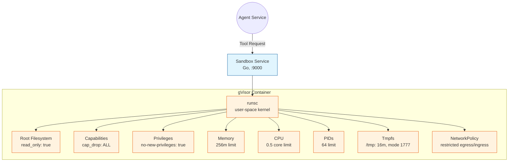
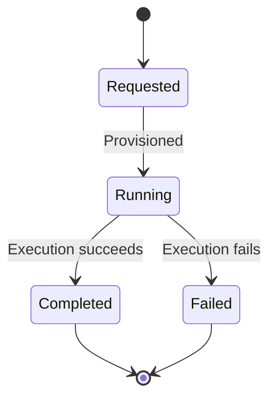

# Sandbox

## Objective

The Sandbox's objective is to **provide isolated, secure execution of agent tools** — running untrusted tool code in gVisor containers with strict resource limits so that agents can safely execute tools without compromising the host.

## What It Does

- Receives tool execution requests from the Agent service.
- Runs each execution in an isolated sandbox with a strict security profile.
- Enforces resource limits (memory, CPU, PIDs, filesystem).
- Reports execution state transitions and results.

## Security Architecture

## Security Hardening

| Control | Setting | Purpose |
|---------|---------|---------|
| Runtime | `runsc` (gVisor) | Kernel-level isolation via user-space kernel |
| Root filesystem | `read_only: true` | Prevent writes to the container image |
| Capabilities | `cap_drop: [ALL]` | Drop all Linux capabilities |
| Privileges | `no-new-privileges: true` | Prevent gaining new privileges |
| Memory | `256m` | Cap RAM usage |
| CPU | `0.5` | Limit to half a CPU core |
| PIDs | `64` | Limit process/thread count |
| Tmpfs | `/tmp:size=16m,mode=1777` | Small writable tmp directory |
| Network | NetworkPolicy | Restricted egress/ingress |

## Sandbox Lifecycle

| State | Meaning |
|-------|---------|
| `Requested` | Sandbox creation requested but not yet provisioned. |
| `Running` | Sandbox is active and accepting executions. |
| `Completed` | Execution finished successfully. |
| `Failed` | Execution failed; reason recorded. |

## Domain Model

| Concept | Description |
|---------|-------------|
| `SandboxSpec` | The desired configuration (resources, network policy, filesystem policy). |
| `SandboxState` | Current lifecycle state of a sandbox. |
| `Execution` | A single tool execution with input, output, and result. |
| `ExecutionResult` | Outcome of an execution (success/failure, output, error). |
| `ResourceLimits` | CPU, memory, PID, and filesystem constraints. |
| `NetworkPolicy` | Allowed/denied network destinations. |
| `FilesystemPolicy` | Allowed/denied filesystem paths and operations. |

## Port

The sandbox service runs on port `9000` and is reachable at `http://sandbox:9000` within Docker Compose.

> **Note:** The sandbox requires gVisor (`runsc`) installed on the host. See `scripts/setup-gvisor.sh` for host setup.
