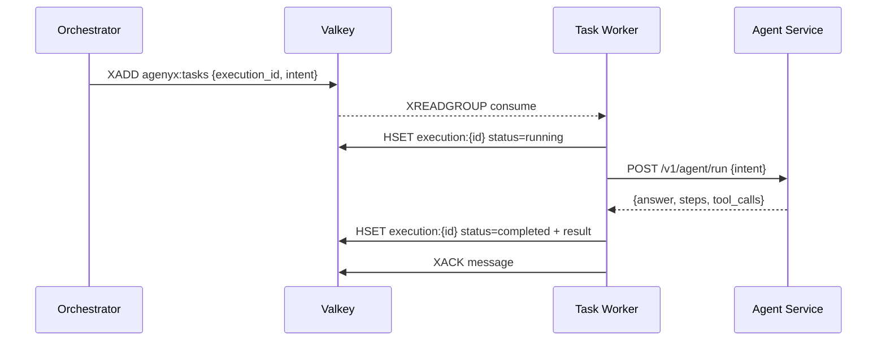
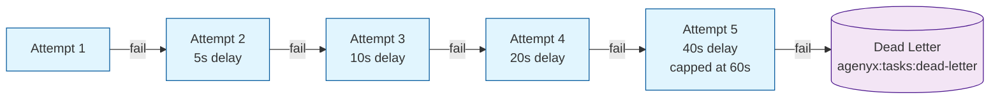

# Task Worker

## Objective

The Task Worker's objective is to **reliably execute queued agent tasks** — consuming from a Valkey stream, calling the Agent service, recording results, and handling failures with retry and dead-lettering.

## What It Does

- Consumes tasks from the Valkey stream (`agenyx:tasks`, default).
- Marks execution state as `running` and records the worker/consumer.
- Calls the Agent service (`POST /v1/agent/run`) with the task intent.
- On success: persists result, marks `completed`, acknowledges the message.
- On failure: retries with exponential backoff; after max attempts, dead-letters and marks `failed`.
- Recovers abandoned pending tasks from other consumers (`XAutoClaim`).

## Architecture

```mermaid
graph TB
    ORC[Orchestrator] -->|XADD| VK_STREAM[(Valkey Stream<br/>agenyx:tasks)]

    subgraph Worker [Task Worker]
        CONSUME[XREADGROUP<br/>consume task]
        MARK[HSET execution:{id}<br/>status=running]
        CALL[POST /v1/agent/run<br/>→ Agent Service]
        SUCCESS[HSET execution:{id}<br/>status=completed + result]
        RETRY[Exponential Backoff<br/>base × 2^(attempt-1)]
        DLQ[Dead Letter Stream<br/>agenyx:tasks:dead-letter]
        RECOVER[XAutoClaim<br/>recover abandoned tasks]
    end

    VK_STREAM --> CONSUME
    CONSUME --> MARK
    MARK --> CALL
    CALL -->|Success| SUCCESS
    CALL -->|Failure| RETRY
    RETRY -->|Attempts exhausted| DLQ
    RETRY -->|Attempts remain| VK_STREAM
    RECOVER -->|Pending tasks| CONSUME

    W[Worker Consumer] -->|Group| VK_STREAM

    classDef proc fill:#e1f5fe,stroke:#01579b;
    classDef store fill:#f3e5f5,stroke:#4a148c;

    class CONSUME,MARK,CALL,SUCCESS,RETRY,DLQ,RECOVER proc;
    class VK_STREAM store;
```

## Task Flow



## Retry Policy

Failed tasks are retried with **exponential backoff**:



| Attempt | Delay (base 5s) |
|---------|-----------------|
| 1 | 5s |
| 2 | 10s |
| 3 | 20s |
| 4 | 40s (capped at `retry_max`, default 60s) |

### Configuration

| Setting | Default | Description |
|---------|---------|-------------|
| `AGENTYX_MAX_ATTEMPTS` | `4` | Maximum execution attempts |
| `AGENTYX_RETRY_BASE_DELAY_SECONDS` | `5` | Base retry delay (seconds) |
| `AGENTYX_RETRY_MAX_DELAY_SECONDS` | `60` | Maximum retry delay (seconds) |
| `AGENTYX_AGENT_TIMEOUT_SECONDS` | `120` | Agent call timeout (seconds) |
| `AGENTYX_PENDING_IDLE_SECONDS` | `10` | Idle time before claiming pending |
| `AGENTYX_PENDING_BATCH_SIZE` | `10` | Batch size for pending recovery |

## Dead-Letter Queue

Tasks that exhaust all retry attempts are published to a dead-letter stream (`agenyx:tasks:dead-letter`) with the execution ID, intent, attempt count, error, and original message ID. The execution state is marked `failed` and the original message is acknowledged so it is not retried indefinitely.

## Pending Recovery

When a worker starts (and periodically), it reclaims pending messages left by other consumers using `XAutoClaim`. If a reclaimed message has a future `retry_at`, it is left pending until that time passes.

## Environment Variables

| Variable | Default | Description |
|----------|---------|-------------|
| `AGENTYX_VALKEY_URL` | `redis://valkey:6379/0` | Valkey connection URL |
| `AGENTYX_TASK_STREAM` | `agenyx:tasks` | Task stream name |
| `AGENTYX_CONSUMER_GROUP` | `agenyx-workers` | Consumer group name |
| `AGENTYX_CONSUMER_NAME` | hostname | Consumer name |
| `AGENTYX_AGENT_URL` | `http://agent:8000` | Agent service URL |

## Execution State Keys

Execution state is stored in Valkey hashes under:

```
agenyx:execution:{execution_id}
```

Fields include `status`, `attempt`, `worker`, `started_at`, `completed_at`, `failed_at`, `answer`, `steps`, `tool_calls`, `error`, `retry_at`, `duration_ms`, and `dead_letter_message_id`.
