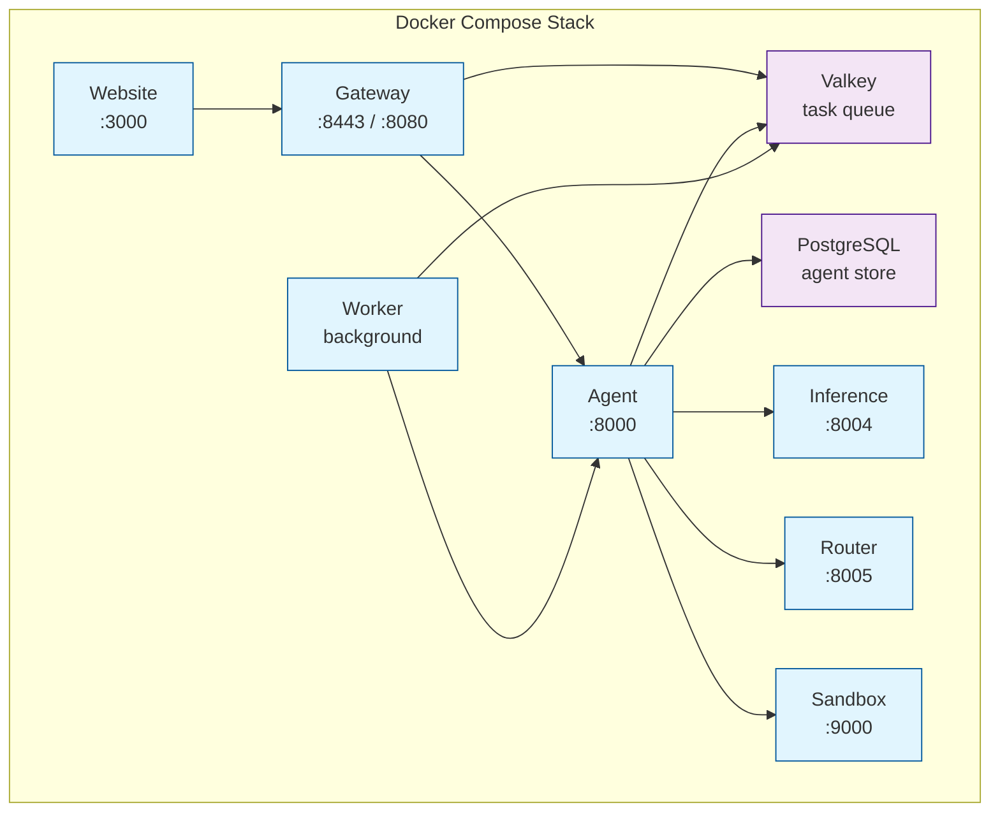

# Deployment

## Objective

The deployment subsystem's objective is to **provide a reliable, reproducible way to run the complete Agenyx platform** — from single-host Docker Compose for development to production-grade Kubernetes with Kustomize.

## Docker Compose

The full stack is defined in `docker-compose.yml` at the repository root.

### Service Architecture



### Services

| Service | Description | Port (host) | Depends on |
|---------|-------------|-------------|------------|
| agent | LLM reasoning & orchestration (Python) | 8000 | postgres, sandbox, inference, router |
| postgres | Durable agent execution storage | 5432 | — |
| router | Semantic model selection (Go) | 8005 | — |
| sandbox | gVisor-isolated tool execution (Go) | 9000 | — |
| inference | OpenAI-compatible LLM gateway (Python) | 8004 | — |
| worker | Python task worker | — | valkey, agent |
| valkey | Task queue & execution state store | — | — |
| gateway | API gateway, auth, rate limiting (Go) | 8080 / 8443 | valkey, agent |
| website | Docs, marketing, AI playground (Next.js) | 3000 | gateway |

### Gateway Ports

The gateway container listens on `:80` (HTTP→HTTPS redirect) and `:443` (HTTPS), mapped to host ports `8080` and `8443`:

- Gateway: `https://localhost:8443`
- Agent: `http://localhost:8000`
- Inference: `http://localhost:8004`
- Router: `http://localhost:8005`

### Running Locally

From the repository root:

```bash
# Prerequisites: Docker, Docker Compose, Git
git clone https://github.com/Sanchar127/Agenyx.git
cd Agenyx

# Configure environment variables in .env
cp .env.example .env   # if present; otherwise create .env

# Start all services
./agenyx serve

# Check running services
docker compose ps

# View logs
docker logs -f agenyx-gateway

# Stop
docker stop $(docker ps -q --filter "name=agenyx")
```

The `./agenyx serve` command validates the Docker Compose configuration, builds all images, and starts the stack with `--wait` (300s timeout). A deployment summary prints the endpoint table.

## Kubernetes

Production manifests live under `deploy/kubernetes/`, organized by component with Kustomize.

### Layout

```
deploy/kubernetes/
├── namespace.yaml
├── kustomization.yaml
├── agent/               # Deployment, Service, HPA, PDB, NetworkPolicy, Secret, ConfigMap, SA
├── inference/           # Deployment, Service, HPA, Servicemonitor, ...
├── router/              # Deployment, Service, ...
├── worker/              # Deployment, Service, HPA, ...
├── orchestrator/        # Deployment, Service, ...
├── valkey/              # Statefulset, Service, ...
├── valkey-single-backup/# Backup configuration
└── monitoring/          # Prometheus, Tempo, Alloy
```

Each component directory contains its own `kustomization.yaml`, and the root `kustomization.yaml` composes them.

### Monitoring

The `monitoring/` directory holds observability components:

- **Prometheus** — metrics collection (`values.yaml`)
- **Tempo** — distributed tracing
- **Alloy** — telemetry collector (DaemonSet, ClusterRole, config)

The Inference service exports Prometheus metrics at `/metrics` and OpenTelemetry traces to the Alloy collector.

## CLI

The `agenyx` CLI (built with Cobra) provides:

| Command | Description |
|---------|-------------|
| `agenyx serve` | Build and deploy the entire platform via Docker Compose |
| `agenyx version` | Display the CLI version (`v0.1.0`) |

## Environment

Create a `.env` file at the repository root with required secrets:

| Variable | Required | Description |
|----------|----------|-------------|
| `AGENEYX_API_KEY` | Yes | Gateway API key |
| `INFERENCE_SERVICE_API_KEY` | Yes | Inference service API key |
| `AGENTYX_DATABASE_URL` | Yes | Agent PostgreSQL URL |
| `AGENEYX_MCP_GATEWAY_TOKEN` | Yes | MCP gateway token |
| `OPENAI_API_KEY` | No | OpenAI provider key |
| `AGENEYX_CORS_ORIGIN` | No | Allowed CORS origin |
