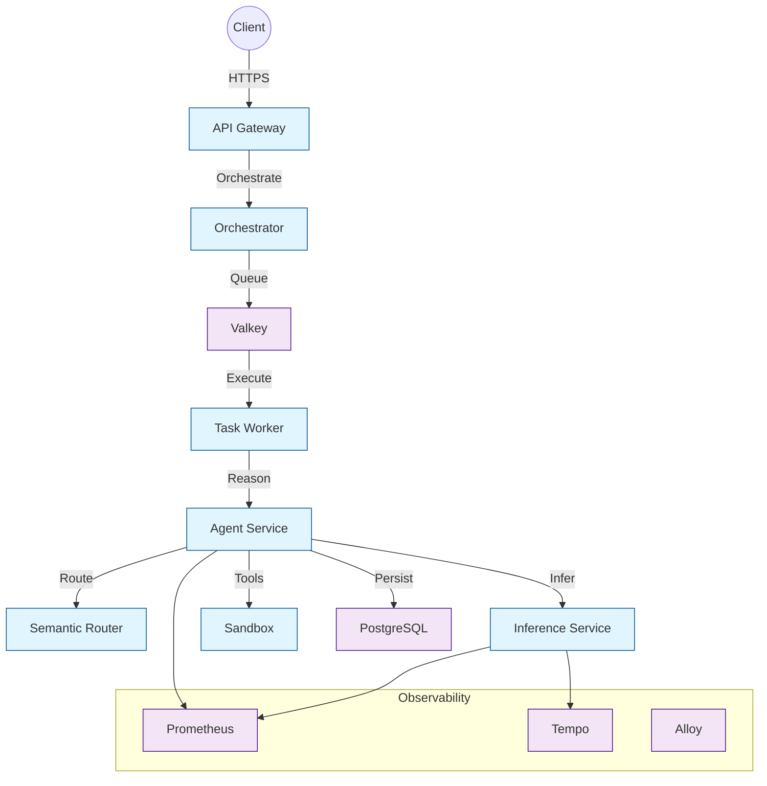

# Operations

This section covers everything you need to deploy, configure, and operate Agenyx in production.

## Subsections

- [Deployment](./deployment.mdx) — Docker Compose and Kubernetes deployment guides
- [Configuration](./configuration.mdx) — Environment variables and configuration reference

## Architecture at a Glance

## Key Operational Concerns

| Concern | Details |
|---------|---------|
| **TLS** | Gateway terminates TLS on `:443`; HTTP `:80` redirects to HTTPS |
| **Secrets** | API keys, database URLs, and MCP tokens via `.env` |
| **Health checks** | `/health/live`, `/health/ready` on gateway; `/health`, `/ready` on inference |
| **Scaling** | Kubernetes HPA configs for agent, inference, worker, router |
| **Backups** | Valkey and PostgreSQL persistent volumes |
| **Monitoring** | Prometheus metrics, OpenTelemetry traces, Alloy collector |
