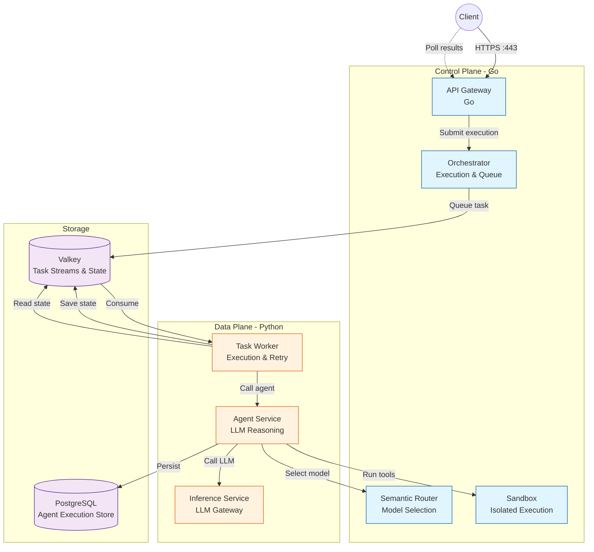
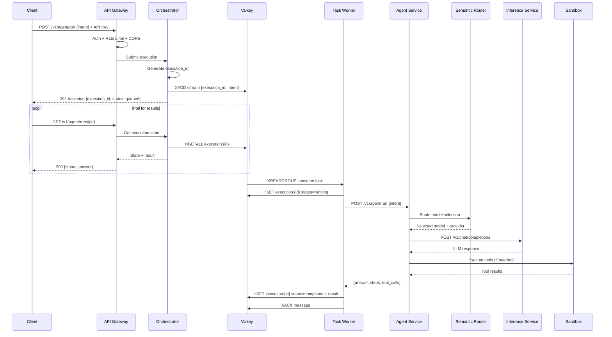

# Overview

**Agenyx** is a runtime for building, deploying, and running AI agents. It brings together AI agent orchestration, model inference, tool execution, and asynchronous task processing in one deployable platform.

Agenyx is designed to make it easier to run and manage AI agents using configurable models and isolated execution environments. The platform is implemented in **Go** (control plane: gateway, orchestrator, router, sandbox daemon, CLI) and **Python** (data plane: agent service, inference gateway, task worker).

## Design Principles

| Principle | Description |
|-----------|-------------|
| **Separation of concerns** | Each subsystem owns a single responsibility: gateway (ingress/auth), orchestrator (task lifecycle), worker (execution), router (model selection), inference (LLM access), sandbox (isolated tool execution), agent (reasoning). |
| **Loose coupling** | Subsystems communicate over HTTP and Valkey streams. The gateway never calls inference directly; it hands execution to the orchestrator, which queues work for workers. |
| **Resilience** | Failover, circuit breaking, retry with exponential backoff, dead-letter queues, and readiness/liveness probes are built in. |
| **Observability** | Structured JSON logging, Prometheus metrics, and OpenTelemetry tracing across services. |
| **Secure by default** | API key authentication, authorization (permissions), CORS, rate limiting, request size limits, security headers, and gVisor sandboxing. |

## Subsystem Map

| Subsystem | Language | Primary Role | Key Ports |
|-----------|----------|--------------|-----------|
| API Gateway | Go | Ingress, auth, rate limiting, health, execution routing | 443 (HTTPS), 80 (HTTP redirect) |
| Orchestrator | Go | Execution submission, task state, Valkey queue | embedded in gateway |
| Task Worker | Go / Python | Consume queued tasks, call agent, retry & dead-letter | embedded |
| Semantic Router | Go | Model selection, scoring, session affinity | 8005 |
| Inference | Python (FastAPI) | OpenAI-compatible LLM gateway, failover, reliability | 8004 |
| Agent | Python | LLM reasoning, tool execution, Postgres persistence | 8000 |
| Sandbox | Go | gVisor-isolated tool execution | 9000 |
| MCP Gateway | Go | Model Context Protocol connectivity | embedded in agent |
| Website | TypeScript (Next.js) | Docs, marketing, AI playground | 3000 |

### Data Stores

| Store | Role |
|-------|------|
| **Valkey** | Task streams, execution state, rate-limiter buckets, router session state |
| **PostgreSQL** | Durable agent execution storage (via the Agent service) |

## System Architecture

## Request Lifecycle

A typical agent execution flows through the platform like this:

> **Note:** Streaming responses (`"stream": true`) are not yet implemented in the Inference service and return `501 Not Implemented`.

## Technology Stack

| Layer | Technology |
|-------|------------|
| Control plane | Go 1.26, Cobra (CLI), go-redis (Valkey) |
| Data plane | Python, FastAPI, valkey-py, pydantic |
| Service mesh / networking | HTTP, reverse proxy, CORS, TLS |
| Container orchestration | Docker Compose, Kubernetes (kustomize) |
| Observability | Prometheus, OpenTelemetry, Alloy, Tempo |
| Frontend | Next.js 16, React 19, Fumadocs, Tailwind CSS |
