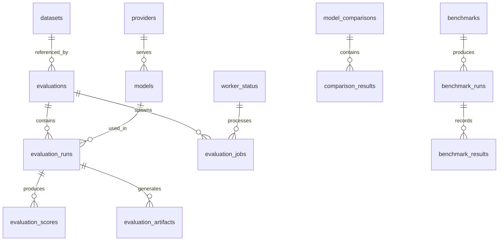

# Evaluation Database Schema

## Design Principles

- **Separate schema**: All evaluation tables use the `evaluation_` prefix to avoid production table contention
- **Normalized**: Evaluations, runs, jobs, scores, models, providers, datasets are separate tables
- **Immutable snapshots**: Evaluation configs store a complete snapshot for reproducibility
- **Large artifacts**: Stored in S3-compatible storage; PostgreSQL stores only metadata and references
- **Migrations**: Alembic (Python) or Go migrate, versioned and tested
- **Indexes**: Appropriate indexes for query patterns (status lookups, model comparisons, time ranges)

## Schema Overview



## Tables

### evaluations

| Column | Type | Constraints | Description |
|--------|------|-------------|-------------|
| id | UUID | PK, default gen_random_uuid() | Evaluation identifier |
| name | VARCHAR(255) | NOT NULL | Human-readable name |
| description | TEXT | | Optional description |
| dataset_id | UUID | FK datasets.id | Source dataset |
| evaluation_type | VARCHAR(50) | NOT NULL | llm, agent, tool, orchestration, sandbox, e2e |
| status | VARCHAR(50) | NOT NULL, default 'queued' | queued, running, completed, failed, cancelled |
| progress | INTEGER | NOT NULL, default 0 | 0-100 |
| priority | VARCHAR(20) | NOT NULL, default 'normal' | low, normal, high, critical |
| timeout_seconds | INTEGER | NOT NULL, default 3600 | Max execution time |
| max_concurrency | INTEGER | NOT NULL, default 5 | Max parallel model runs |
| config_snapshot | JSONB | NOT NULL | Immutable config for reproducibility |
| metadata | JSONB | | Arbitrary metadata |
| created_by | VARCHAR(255) | | User who created |
| created_at | TIMESTAMPTZ | NOT NULL, default now() | Creation timestamp |
| completed_at | TIMESTAMPTZ | | Completion timestamp |
| error_message | TEXT | | Error if failed |

**Indexes**: `idx_evaluations_status`, `idx_evaluations_created_at`, `idx_evaluations_dataset_id`

### evaluation_runs

| Column | Type | Constraints | Description |
|--------|------|-------------|-------------|
| id | UUID | PK, default gen_random_uuid() | Run identifier |
| evaluation_id | UUID | FK evaluations.id | Parent evaluation |
| model_id | VARCHAR(255) | FK models.model_id | Model evaluated |
| provider_id | VARCHAR(255) | FK providers.provider_id | Provider used |
| status | VARCHAR(50) | NOT NULL, default 'queued' | queued, running, completed, failed |
| success_rate | NUMERIC(5,4) | | 0.0-1.0 |
| avg_latency_ms | INTEGER | | Average latency |
| p50_latency_ms | INTEGER | | p50 latency |
| p95_latency_ms | INTEGER | | p95 latency |
| p99_latency_ms | INTEGER | | p99 latency |
| total_tokens | INTEGER | | Input + output tokens |
| total_cost_usd | NUMERIC(10,6) | | Estimated cost |
| error_count | INTEGER | | Error count |
| config_snapshot | JSONB | NOT NULL | Run-specific config |
| started_at | TIMESTAMPTZ | | Start timestamp |
| completed_at | TIMESTAMPTZ | | Completion timestamp |
| error_message | TEXT | | Error if failed |

**Indexes**: `idx_evaluation_runs_evaluation_id`, `idx_evaluation_runs_model_id`, `idx_evaluation_runs_status`

### evaluation_jobs

| Column | Type | Constraints | Description |
|--------|------|-------------|-------------|
| id | UUID | PK, default gen_random_uuid() | Job identifier |
| evaluation_id | UUID | FK evaluations.id | Parent evaluation |
| run_id | UUID | FK evaluation_runs.id | Associated run |
| worker_id | VARCHAR(255) | FK worker_status.id | Assigned worker |
| status | VARCHAR(50) | NOT NULL, default 'queued' | queued, claimed, running, completed, failed, dlq |
| attempt | INTEGER | NOT NULL, default 0 | Retry attempt |
| max_attempts | INTEGER | NOT NULL, default 3 | Max retries |
| lease_expires_at | TIMESTAMPTZ | | Lease expiration for worker ownership |
| created_at | TIMESTAMPTZ | NOT NULL, default now() | Creation timestamp |
| started_at | TIMESTAMPTZ | | Start timestamp |
| completed_at | TIMESTAMPTZ | | Completion timestamp |

**Indexes**: `idx_evaluation_jobs_status`, `idx_evaluation_jobs_lease_expires_at`, `idx_evaluation_jobs_worker_id`

### models

| Column | Type | Constraints | Description |
|--------|------|-------------|-------------|
| model_id | VARCHAR(255) | PK | Model identifier |
| provider_id | VARCHAR(255) | FK providers.provider_id | Serving provider |
| display_name | VARCHAR(255) | | Human-readable name |
| context_window | INTEGER | | Max context tokens |
| capabilities | JSONB | | ["chat", "tool_use", "json_mode"] |
| endpoint_config | JSONB | | base_url, auth_ref |
| generation_defaults | JSONB | | temperature, max_tokens |
| timeout_seconds | INTEGER | NOT NULL, default 120 | Request timeout |
| retry_config | JSONB | | max_retries, base_delay |
| health_status | VARCHAR(20) | | healthy, degraded, unhealthy, unknown |
| health_checked_at | TIMESTAMPTZ | | Last health check |
| created_at | TIMESTAMPTZ | NOT NULL, default now() | Registration timestamp |
| updated_at | TIMESTAMPTZ | NOT NULL, default now() | Last update timestamp |

**Indexes**: `idx_models_provider_id`, `idx_models_health_status`

### providers

| Column | Type | Constraints | Description |
|--------|------|-------------|-------------|
| provider_id | VARCHAR(255) | PK | Provider identifier |
| display_name | VARCHAR(255) | | Human-readable name |
| provider_type | VARCHAR(50) | NOT NULL | ollama, vllm, openai, anthropic, openai-compatible |
| endpoint_url | VARCHAR(500) | NOT NULL | Base endpoint URL |
| auth_ref | VARCHAR(255) | | Secret reference (not plaintext) |
| capabilities | JSONB | | Supported capabilities |
| health_status | VARCHAR(20) | | healthy, degraded, unhealthy, unknown |
| created_at | TIMESTAMPTZ | NOT NULL, default now() | Registration timestamp |

**Indexes**: `idx_providers_provider_type`, `idx_providers_health_status`

### datasets

| Column | Type | Constraints | Description |
|--------|------|-------------|-------------|
| id | UUID | PK, default gen_random_uuid() | Dataset identifier |
| name | VARCHAR(255) | NOT NULL | Dataset name |
| version | VARCHAR(100) | NOT NULL | Dataset version |
| checksum | VARCHAR(64) | NOT NULL | SHA-256 checksum |
| s3_uri | VARCHAR(1000) | NOT NULL | S3 artifact URI |
| row_count | INTEGER | | Number of records |
| schema_json | JSONB | | Dataset schema |
| description | TEXT | | Optional description |
| created_by | VARCHAR(255) | | Uploader |
| created_at | TIMESTAMPTZ | NOT NULL, default now() | Upload timestamp |

**Indexes**: `idx_datasets_name_version`, `idx_datasets_checksum`

**Unique constraint**: `(name, version)`

### benchmarks

| Column | Type | Constraints | Description |
|--------|------|-------------|-------------|
| id | UUID | PK, default gen_random_uuid() | Benchmark identifier |
| name | VARCHAR(255) | NOT NULL | Benchmark name |
| benchmark_type | VARCHAR(50) | NOT NULL | runtime, throughput, latency, concurrency, reliability, resource |
| target_service | VARCHAR(100) | | Target Agenyx service |
| target_url | VARCHAR(500) | | Target endpoint |
| config_snapshot | JSONB | NOT NULL | Immutable benchmark config |
| created_by | VARCHAR(255) | | Creator |
| created_at | TIMESTAMPTZ | NOT NULL, default now() | Creation timestamp |

### benchmark_runs

| Column | Type | Constraints | Description |
|--------|------|-------------|-------------|
| id | UUID | PK, default gen_random_uuid() | Run identifier |
| benchmark_id | UUID | FK benchmarks.id | Parent benchmark |
| status | VARCHAR(50) | NOT NULL | queued, running, completed, failed |
| config_snapshot | JSONB | NOT NULL | Run config snapshot |
| started_at | TIMESTAMPTZ | | Start timestamp |
| completed_at | TIMESTAMPTZ | | Completion timestamp |

### benchmark_results

| Column | Type | Constraints | Description |
|--------|------|-------------|-------------|
| id | UUID | PK, default gen_random_uuid() | Result identifier |
| run_id | UUID | FK benchmark_runs.id | Parent run |
| metric_name | VARCHAR(100) | NOT NULL | rps, p50_latency, etc. |
| metric_value | NUMERIC(15,6) | NOT NULL | Measured value |
| metric_unit | VARCHAR(50) | | req/s, ms, percent |
| concurrency_level | INTEGER | | Concurrency at measurement |
| recorded_at | TIMESTAMPTZ | NOT NULL, default now() | Measurement timestamp |

**Indexes**: `idx_benchmark_results_run_id`, `idx_benchmark_results_metric_name`

### evaluation_scores

| Column | Type | Constraints | Description |
|--------|------|-------------|-------------|
| id | UUID | PK, default gen_random_uuid() | Score identifier |
| run_id | UUID | FK evaluation_runs.id | Parent run |
| scorer_name | VARCHAR(100) | NOT NULL | Scorer identifier |
| score_name | VARCHAR(100) | NOT NULL | Specific score metric |
| score_value | NUMERIC(10,6) | NOT NULL | Score (0-1 or raw) |
| score_unit | VARCHAR(50) | | percent, raw, count |
| details | JSONB | | Scorer-specific details |
| recorded_at | TIMESTAMPTZ | NOT NULL, default now() | Record timestamp |

**Indexes**: `idx_evaluation_scores_run_id`, `idx_evaluation_scores_scorer_name`

### evaluation_artifacts

| Column | Type | Constraints | Description |
|--------|------|-------------|-------------|
| id | UUID | PK, default gen_random_uuid() | Artifact identifier |
| run_id | UUID | FK evaluation_runs.id | Parent run |
| artifact_type | VARCHAR(50) | NOT NULL | trace, log, screenshot, report |
| s3_uri | VARCHAR(1000) | NOT NULL | S3 object URI |
| size_bytes | INTEGER | | Artifact size |
| checksum | VARCHAR(64) | | SHA-256 checksum |
| created_at | TIMESTAMPTZ | NOT NULL, default now() | Upload timestamp |

**Indexes**: `idx_evaluation_artifacts_run_id`

### model_comparisons

| Column | Type | Constraints | Description |
|--------|------|-------------|-------------|
| id | UUID | PK, default gen_random_uuid() | Comparison identifier |
| name | VARCHAR(255) | NOT NULL | Comparison name |
| status | VARCHAR(50) | NOT NULL | queued, running, completed, failed |
| created_by | VARCHAR(255) | | Creator |
| created_at | TIMESTAMPTZ | NOT NULL, default now() | Creation timestamp |
| completed_at | TIMESTAMPTZ | | Completion timestamp |

### comparison_results

| Column | Type | Constraints | Description |
|--------|------|-------------|-------------|
| id | UUID | PK, default gen_random_uuid() | Result identifier |
| comparison_id | UUID | FK model_comparisons.id | Parent comparison |
| metric_name | VARCHAR(100) | NOT NULL | Metric compared |
| results | JSONB | NOT NULL | Per-run values |
| difference | NUMERIC(15,6) | | Difference between runs |
| significant | BOOLEAN | | Statistical significance |
| p_value | NUMERIC(10,6) | | P-value for significance |
| recorded_at | TIMESTAMPTZ | NOT NULL, default now() | Record timestamp |

**Indexes**: `idx_comparison_results_comparison_id`

### worker_status

| Column | Type | Constraints | Description |
|--------|------|-------------|-------------|
| id | UUID | PK, default gen_random_uuid() | Worker identifier |
| worker_type | VARCHAR(50) | NOT NULL | ai_eval, benchmark, load_test |
| worker_name | VARCHAR(255) | NOT NULL | Worker instance name |
| status | VARCHAR(20) | NOT NULL | active, idle, unhealthy, offline |
| current_job_id | UUID | FK evaluation_jobs.id | Currently processing |
| capacity | INTEGER | NOT NULL | Max concurrent jobs |
| current_load | INTEGER | NOT NULL, default 0 | Current job count |
| last_heartbeat | TIMESTAMPTZ | | Last heartbeat |
| metadata | JSONB | | Worker metadata |
| registered_at | TIMESTAMPTZ | NOT NULL, default now() | Registration timestamp |

**Indexes**: `idx_worker_status_type`, `idx_worker_status_status`, `idx_worker_status_last_heartbeat`

## Migrations

Evaluation migrations use Alembic (Python) and live at:

```
internal/agent/alembic/versions/
  001_evaluation_schema.py
  002_evaluation_benchmarks.py
  003_evaluation_comparisons.py
```

Migration `001_evaluation_schema.py` creates all `evaluation_*` tables, indexes, and constraints.

## Production Performance Considerations

1. **Partitioning**: `evaluation_runs` and `evaluation_scores` may be partitioned by month if volume exceeds 10M rows
2. **Archival**: Evaluations older than 90 days can be archived to S3 and soft-deleted
3. **Connection pool**: Evaluation API uses a separate connection pool (max 20 connections) to avoid production contention
4. **Read replicas**: Evaluation read queries can target read replicas when available
